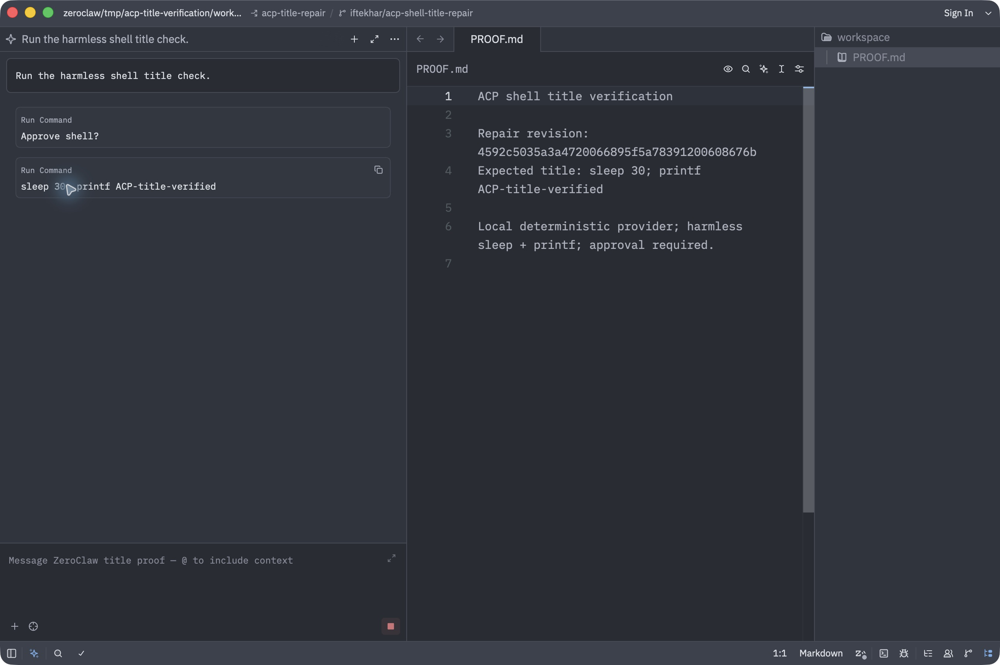
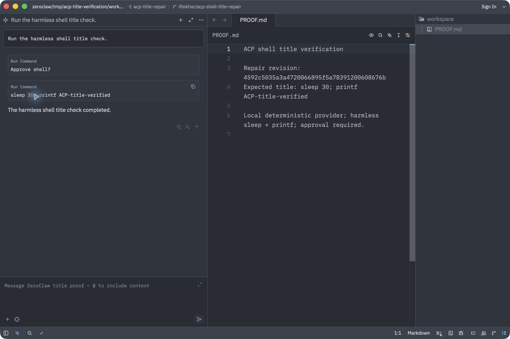
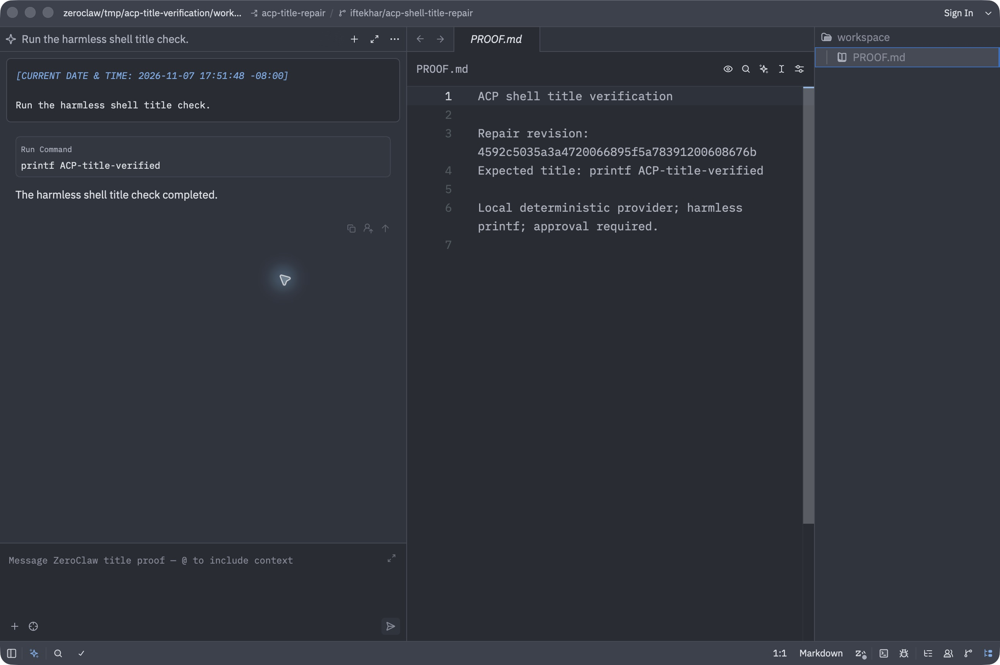

# PR #12286 repair and verification

The title truncation test failed to compile in the required `ci-all` lint build. The repair builds the same long fixture with `format!("echo {}", "a".repeat(200))`. The existing truncation assertions are retained.

The repair is commit `4592c5035a3a4720066895f5a78391200608676b`, based directly on PR head `3c6382115e65ff94bdd925a3a45e4f20713e4152`. The code branch is [`iftekhar/acp-shell-title-repair`](https://github.com/IftekharUddin/zeroclaw/tree/iftekhar/acp-shell-title-repair). This verification branch carries the evidence assets separately.

To apply the repair to the original PR branch:

```sh
git fetch https://github.com/IftekharUddin/zeroclaw.git iftekhar/acp-shell-title-repair
git cherry-pick 4592c5035a3a4720066895f5a78391200608676b
```

## Results

Checked on macOS 26.5.1 / Apple Silicon with Rust 1.97.1 and Zed 1.27.0, on 2026-11-07 (Pacific time).

| Check | Result |
| --- | --- |
| `cargo fmt --all -- --check` | Passed |
| `cargo clippy --locked --workspace --exclude zeroclaw-desktop --all-targets --features ci-all -- -D warnings` | Passed |
| `cargo test --locked -p zeroclaw-channels --lib orchestrator::acp_server::tests -- --test-threads=4` | 130 passed, 0 failed |
| `cargo build --locked --bin zeroclaw --no-default-features --features agent-runtime,channel-acp-server` | Passed; macOS debug linker emitted an unwind-table-size advisory |
| Real stdio server → shell → SQLite → `session/load` | Passed; see [wire smoke output](wire-smoke.log) and [transcript](wire-smoke-transcript.json) |
| Zed rendered title, pending and completed | Passed |
| Zed rendered title after `session/load` | Passed; see [client transcript](zed-transcript.json) |

The built executable reports `zeroclaw 0.8.7 (v0.8.7-85-g4592c5035a)`. [Verification metadata](verification.json) records its SHA-256, log hashes, revision, and screenshot descriptions. Cargo used an existing shared target cache. These are local checks; the original PR still needs its hosted checks to rerun after the author applies the commit. Gateway WebSocket and Thunderbolt rendering were not exercised.

## What the client check proves

A local deterministic OpenAI-compatible provider returned a real `shell` tool call with extra whitespace in its command. The built ZeroClaw server handled the ACP request, asked for approval, executed the allowlisted command, persisted the conversation, and replayed it after reload. Zed received the actual server notifications through a transparent stdio logger and rendered them. The provider fixture supplied model responses only; the server, tool execution, database, transport, and client renderer were real.

The slow command was `sleep 30; printf ACP-title-verified`. The delay made the pending state observable. The title was normalized to that command during execution and retained after completion. An earlier `printf ACP-title-verified` session and the slow-command session both retained their titles after `session/load`.

The approval prompt is a separate card labeled `Approve shell?`. The screenshots verify the command title on the tool-call card that appears after approval.

### Pending

The command is still running, with the stop control present and no final response yet.



### Completed

The same title remains after the final response arrives.



### Reloaded

This screenshot shows the earlier printf-only session after `session/load`. The replayed prompt contains the stored timestamp, the approval card has disappeared, and the command title remains. The client transcript also records the subsequent successful reload of the slow-command session.



## Reproducing the boundary check

Build the repair revision with the command above. Copy the built executable beside these three Python scripts as `zeroclaw`, then start `python3 mock_provider.py` from this evidence directory. It binds only to loopback, writes an isolated fixture config, and prints its port. Run `python3 wire_smoke.py` in another terminal; it creates its own config directory, exercises live notifications and persisted replay, and asserts the titles, statuses, and shell output. The fixture automatically approves only its own harmless test command.

For Zed, use an isolated `--user-data-dir` profile and add a custom agent whose command is Python 3 and whose argument is the absolute path to `acp_wrapper.py`, following [Zed's custom-agent documentation](https://zed.dev/docs/ai/external-agents). Open the fixture `workspace` folder, start a thread with that agent, send `Run the harmless shell title check.`, and choose **Allow once**. Capture the tool card during the 30-second delay and after completion. Use **Reload Agent** to trigger saved-session loading.

During this run, a second Zed reload retained an earlier connection and attempted to start another standalone ACP process against the same fixture config. The config ownership guard rejected that concurrent process. Stopping the earlier fixture connection and choosing **Retry** completed `session/load`; the title remained correct. Keep one standalone ACP process per config when reproducing the check.

Logs have local filesystem prefixes replaced with `<checkout>`, `<verification>`, or `<user>`. All model and shell content in this evidence is synthetic. No live daemon or external model account was used.

## Scope and rollback

The repair changes one test-fixture expression. Its runtime behavior and configuration footprint are empty. Reverting the repair commit restores the original test expression and its `ci-all` compilation failure. The evidence scripts and screenshots are confined to this separate verification branch.
